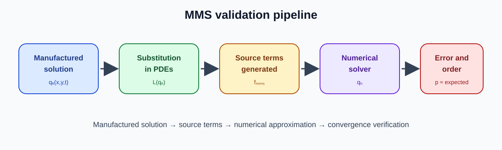
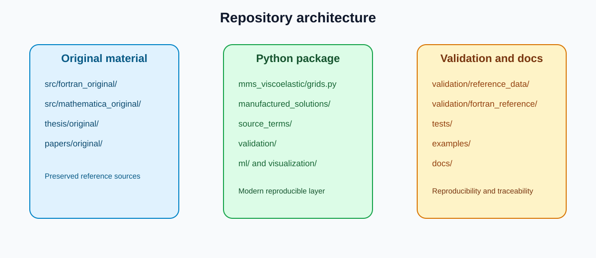
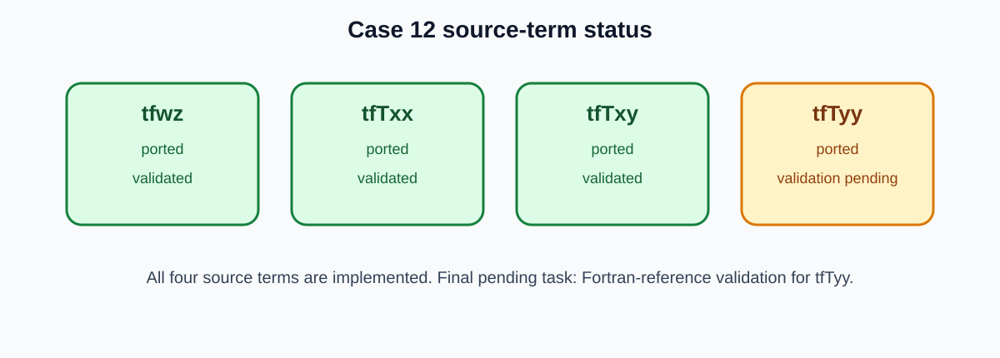

# Thesis USP Codes - MMS Verification and Python Modernization

Repository associated with the doctoral thesis of **Juniormar Organista**, focused on the numerical verification of high-order solvers for incompressible viscoelastic flows using the **Method of Manufactured Solutions (MMS)**.

---

## Table of contents

1. [Project vision](#project-vision)
2. [Scientific context](#scientific-context)
3. [Mathematical formulation](#mathematical-formulation)
4. [Method of Manufactured Solutions](#method-of-manufactured-solutions)
5. [Numerical verification](#numerical-verification)
6. [Convergence results (Case 12)](#convergence-results-case-12)
7. [Thesis figures in this README](#thesis-figures-in-this-readme)
8. [Current Python status](#current-python-status)
9. [Case 12 status](#case-12-status)
10. [Time-marching solver (Case 12)](#time-marching-solver-case-12)
11. [Repository structure](#repository-structure)
12. [Installation](#installation)
13. [Tests and validation](#tests-and-validation)
14. [Examples](#examples)
15. [Generated outputs](#generated-outputs)
16. [Machine Learning preparation](#machine-learning-preparation)
17. [GitHub workflow](#github-workflow)
18. [GitHub About](#github-about)
19. [Citation](#citation)
20. [Author](#author)
21. [README maintenance rule](#readme-maintenance-rule)

---

## Project vision

The project has two complementary goals.

First, it preserves the scientific material associated with the doctoral thesis. The original sources remain available for traceability, historical inspection and comparison:

```text
src/fortran_original/
src/mathematica_original/
thesis/original/
papers/original/
```

Second, it builds a modern Python package:

```text
src/mms_viscoelastic/
```

The Python layer is being organized as a real scientific package with tests, validation data, examples, source-term ports, visualization utilities and future ML-ready datasets.

The long-term objective is to transform a thesis codebase into a reproducible scientific computing framework.

---

## Scientific context

The thesis concerns the numerical verification of high-order computational solvers for **incompressible viscoelastic flows**.

Viscoelastic flows are challenging because the flow field is coupled with polymeric stress evolution. In practice, the solver must handle:

- velocity components;
- streamfunction;
- scalar vorticity;
- stress tensor components;
- nonlinear constitutive terms;
- stiffness associated with the Weissenberg number;
- high-order spatial discretization;
- manufactured forcing terms.

The central scientific question is:

> Given an exact manufactured solution, does the implemented numerical method recover the expected theoretical order of accuracy?

This is a code-verification problem, not merely a simulation problem.

---

## Mathematical formulation

### Incompressibility

For an incompressible flow, the velocity field satisfies:

```math
\nabla \cdot \mathbf{u} = 0.
```

In two dimensions:

```math
\mathbf{u}(x,y,t) = (u(x,y,t), v(x,y,t)).
```

Thus:

```math
\frac{\partial u}{\partial x}
+
\frac{\partial v}{\partial y}
=
0.
```

### Streamfunction formulation

For two-dimensional incompressible flows, a streamfunction $\psi$ can be introduced so that:

```math
u =
\frac{\partial \psi}{\partial y},
\qquad
v =
-\frac{\partial \psi}{\partial x}.
```

This automatically satisfies incompressibility.

### Vorticity

The scalar vorticity is defined as:

```math
\omega_z =
\frac{\partial v}{\partial x}
-
\frac{\partial u}{\partial y}.
```

Using the streamfunction definition:

```math
\omega_z = -\nabla^2 \psi,
\qquad
\nabla^2 \psi = -\omega_z.
```

### Rate-of-deformation tensor

The symmetric rate-of-deformation tensor is:

```math
\mathbf{D}
=
\frac{1}{2}
\left(
\nabla\mathbf{u}
+
\nabla\mathbf{u}^{T}
\right).
```

For two-dimensional velocity fields:

```math
\mathbf{D}
=
\begin{bmatrix}
\frac{\partial u}{\partial x}
&
\frac{1}{2}
\left(
\frac{\partial u}{\partial y}
+
\frac{\partial v}{\partial x}
\right)
\\[4pt]
\frac{1}{2}
\left(
\frac{\partial u}{\partial y}
+
\frac{\partial v}{\partial x}
\right)
&
\frac{\partial v}{\partial y}
\end{bmatrix}.
```

### Generic viscoelastic constitutive structure

A broad representation of the viscoelastic stress equation may be written as:

```math
\mathrm{Wi}\,\mathcal{D}\boldsymbol{\tau}
+
\mathcal{F}
\left(
\boldsymbol{\tau},
\nabla \mathbf{u}
\right)
=
2(1-\beta)\mathbf{D}.
```

Here:

- $\boldsymbol{\tau}$ is the polymeric extra-stress tensor;
- $\mathrm{Wi}$ is the Weissenberg number;
- $\beta$ is the solvent-viscosity ratio;
- $\mathcal{D}$ denotes a suitable material or objective derivative;
- $\mathcal{F}$ depends on the chosen constitutive model.

The thesis framework involves models such as:

- UCM;
- Oldroyd-B;
- Giesekus;
- LPTT.

### Stress tensor components

```math
\boldsymbol{\tau}
=
\begin{bmatrix}
T_{xx} & T_{xy}
\\
T_{xy} & T_{yy}
\end{bmatrix}.
```

---

## Method of Manufactured Solutions

The **Method of Manufactured Solutions** is a rigorous technique for code verification. Instead of searching for a natural exact solution of the governing equations, one prescribes an artificial but smooth exact solution and computes the forcing terms that make it satisfy the equations exactly.

The manufactured state vector is:

```math
\mathbf{q}_e(x,y,t)
=
\left(
u_e,
v_e,
\psi_e,
\omega_{z,e},
T_{xx,e},
T_{xy,e},
T_{yy,e}
\right).
```

Substituting this manufactured field into the continuous governing equations gives:

```math
\mathcal{L}
\left(
\mathbf{q}_e
\right)
=
\mathbf{f}_{\mathrm{MMS}}.
```

The manufactured source vector contains terms such as:

```math
\mathbf{f}_{\mathrm{MMS}}
=
\left(
f_{\omega_z},
f_{T_{xx}},
f_{T_{xy}},
f_{T_{yy}}
\right).
```

In the original Fortran Case 12 implementation, these are represented by:

```text
tfwz
tfTxx
tfTxy
tfTyy
```

The Python port keeps the same scientific meaning while using NumPy array convention:

```text
(ny, nx)
```

---

## Numerical verification

Given a numerical approximation $\mathbf{q}_h$ on a grid of characteristic spacing $h$, the error is:

```math
\mathbf{e}_h
=
\mathbf{q}_h
-
\mathbf{q}_e.
```

Typical norms include:

```math
\lVert e_h \rVert_{2}
=
\left(
\frac{1}{N}
\sum_{i=1}^{N}
e_i^2
\right)^{1/2},
```

and:

```math
\lVert e_h \rVert_{\infty}
=
\max_i |e_i|.
```

The observed order of convergence is estimated by:

```math
p
=
\frac{
\log(E_{h1}/E_{h2})
}{
\log(h1/h2)
}.
```

For a fourth-order method, the expected behavior is approximately:

```math
E_h = C h^4,
\qquad
p \approx 4.
```

---

## Convergence results (Case 12)

This section reports a concrete instance of the verification described above,
applied to Case 12. It checks that the second-order operators in
[`numerics/derivatives.py`](src/mms_viscoelastic/numerics/derivatives.py)
reproduce the stream-function identities

```math
u = \frac{\partial \psi}{\partial y},
\qquad
v = -\frac{\partial \psi}{\partial x},
\qquad
w_z = \frac{\partial u}{\partial y} - \frac{\partial v}{\partial x}
```

at the expected order $p=2$, using
[`run_convergence_study`](src/mms_viscoelastic/numerics/convergence.py). These
three relations were verified symbolically with SymPy to hold exactly for the
Case 12 manufactured solution - substituting the closed-form expressions for
$u$, $v$, $\psi$ and $w_z$ and simplifying each residual gives `0` for
arbitrary $x$, $y$, $t$ - so any nonzero error below is purely discretization
error, not a defect in the manufactured fields.

> **Sign convention.** The `wz` field used here, and in the original
> `case_12.f`, equals $\partial u/\partial y - \partial v/\partial x =
> +\nabla^2\psi$, which is the *negative* of the $\omega_z =
> \partial v/\partial x - \partial u/\partial y = -\nabla^2\psi$ defined in
> [Mathematical formulation](#mathematical-formulation). The Python port keeps
> the convention of the original Fortran code so that field-by-field
> comparisons against `case_12.f` remain direct. See
> [`docs/case-12-complete-validation-report.md`](docs/case-12-complete-validation-report.md#12-a-note-on-the-sign-of-wz)
> for the full discussion.

Results for grids $n = 8, 16, 32, 64$ ($h = 1/n$):

| $n$ | $h$ | $L_2(u)$ | $L_\infty(u)$ | $L_2(v)$ | $L_\infty(v)$ | $L_2(w_z)$ | $L_\infty(w_z)$ |
|----|----------|----------|----------|----------|----------|----------|----------|
| 8  | 1.25e-01 | 9.17e-03 | 2.37e-02 | 2.98e-02 | 8.05e-02 | 1.19e-01 | 2.84e-01 |
| 16 | 6.25e-02 | 2.36e-03 | 8.08e-03 | 6.46e-03 | 1.79e-02 | 3.19e-02 | 7.31e-02 |
| 32 | 3.13e-02 | 5.83e-04 | 2.28e-03 | 1.50e-03 | 4.06e-03 | 7.89e-03 | 2.05e-02 |
| 64 | 1.56e-02 | 1.43e-04 | 6.01e-04 | 3.62e-04 | 9.54e-04 | 1.93e-03 | 5.50e-03 |

Estimated order of accuracy (log-log fit across all four grids):

| Quantity | $p$ ($L_2$) | $p$ ($L_\infty$) |
|----------|----------|------------|
| $u$      | 2.0021   | 1.7726     |
| $v$      | 2.1198   | 2.1332     |
| $w_z$    | 1.9854   | 1.8902     |

All three $L_2$ orders are within 6% of the theoretical value $p=2$. The
lower $L_\infty(u)$ order (1.77) comes from the one-sided boundary stencil,
whose truncation-error constant is larger than the interior
central-difference constant; it does not affect the $L_2$ rate, which
averages over the much larger set of interior points and recovers
$p\approx2.00$.

Reproduce with:

```powershell
python examples\09_case12_convergence_verification.py
python -m pytest tests\test_case12_convergence.py -v
```

Full derivations (symbolic verification, truncation-error analysis) and the
consolidated source-term validation results are in
[`docs/case-12-convergence-verification.md`](docs/case-12-convergence-verification.md)
and
[`docs/case-12-complete-validation-report.md`](docs/case-12-complete-validation-report.md).
A reproducible end-to-end notebook is available at
[`examples/notebooks/Case12_MMS_Pipeline.ipynb`](examples/notebooks/Case12_MMS_Pipeline.ipynb).

---

## Thesis figures in this README

The figures below come from the thesis/slides material. The original files were mostly EPS, converted to PNG only so GitHub can render them. The original thesis assets remain preserved separately.

Documentation for the selected figures is available in:

```text
docs/thesis-figures-used-in-readme.md
```

### Visual intuition

<p align="center">
  
</p>

### MMS validation pipeline

<p align="center">
  
</p>

### Case 12 exact maps

| $\psi$ | $u$ |
|---|---|
|  |  |

| $v$ | $\omega_z$ |
|---|---|
|  |  |

| $T_{xx}$ | $T_{xy}$ | $T_{yy}$ |
|---|---|---|
|  |  |  |

### Case 12 exact surfaces

| $\psi$ | $u$ |
|---|---|
|  |  |

| $\omega_z$ | $T_{xx}$ |
|---|---|
|  |  |

### Convergence curves from thesis material

| $\psi$ | $u$ |
|---|---|
|  |  |

| $v$ | $\omega_z$ |
|---|---|
|  |  |

| $T_{xx}$ | $T_{xy}$ | $T_{yy}$ |
|---|---|---|
|  |  |  |

### Numerical slices

| Slice in $x$ for $u$ | Slice in $y$ for $\omega_z$ |
|---|---|
|  |  |

### Repository architecture and current source-term status

<p align="center">
  
</p>

<p align="center">
  
</p>

---

## Current Python status

The Python modernization currently includes:

- package foundation under `src/mms_viscoelastic`;
- grid utilities;
- manufactured solution utilities;
- numerical derivative, error and convergence utilities;
- visualization utilities;
- ML-ready dataset construction;
- source-term ports for Case 12;
- Fortran-reference validation for all four Case 12 source terms;
- grid-convergence verification for the stream-function identities;
- constitutive models (UCM, Oldroyd-B), validated against closed-form steady
  Couette solutions (see [Constitutive models](docs/constitutive-models.md));
- a direct Poisson solver for `psi`, an explicit Euler time step for `wz` and
  the stress tensor, and a full single/multi-step time-marching update for
  Case 12, each validated against isolated Fortran reference programs (see
  [Time-marching solver (Case 12)](#time-marching-solver-case-12));
- regression tests with `pytest`;
- examples and a reproducible notebook for Case 12.

### Implemented source terms

```text
tfwz   ported and validated against Fortran reference
tfTxx  ported and validated against Fortran reference
tfTxy  ported and validated against Fortran reference
tfTyy  ported and validated against Fortran reference
```

### Pending work

```text
expanded datasets for ML workflows
full temporal-evolution comparison against the original Fortran solver's
  own time loop (full simulation horizon, finer grids)
4th-order LPOG compact operators and the Lele compact filter
  (currently out of scope; 2nd-order operators are used instead)
presentation material for thesis defense
```

---

## Case 12 status

Case 12 is currently the main Python modernization target.

### Original reference

```text
src/fortran_original/4Order_LPOG_Euler/case_12.f
```

### Python modules

```text
src/mms_viscoelastic/manufactured_solutions/case_12.py
src/mms_viscoelastic/source_terms/case_12.py
src/mms_viscoelastic/validation/source_term_reference.py
```

### Exact fields

```text
u
v
psi
wz
txx
txy
tyy
```

### Source-term API

```python
from mms_viscoelastic.grids import Grid2D
from mms_viscoelastic.source_terms import evaluate_case_12_source_terms

grid = Grid2D.from_bounds(nx=65, ny=65)
terms = evaluate_case_12_source_terms(grid)

terms.tfwz
terms.tfTxx
terms.tfTxy
terms.tfTyy
```

---

## Time-marching solver (Case 12)

`src/mms_viscoelastic/numerics/` ports, with 2nd-order finite-difference
operators, the building blocks of the Case 12 time-marching loop from
`src/fortran_original/4Order_LPOG_Euler/`. Each step is validated against an
isolated Fortran reference program written for this project (it does not
modify the original thesis Fortran sources).

| Step | Module | Documentation |
|---|---|---|
| Direct Poisson solve for `psi` (`laplacian(psi) = wz`, Dirichlet BCs) | [`numerics/poisson.py`](src/mms_viscoelastic/numerics/poisson.py) | [`docs/case-12-poisson-solver.md`](docs/case-12-poisson-solver.md) |
| Explicit Euler step for `wz`, `Txx`, `Txy`, `Tyy` | [`numerics/time_stepping.py`](src/mms_viscoelastic/numerics/time_stepping.py) | [`docs/case-12-euler-step-comparison.md`](docs/case-12-euler-step-comparison.md) |
| Full step: Euler update + boundary conditions at `t+dt` + Poisson re-solve + `u`,`v` recomputation | [`numerics/time_marching.py`](src/mms_viscoelastic/numerics/time_marching.py) (`case12_time_step`) | [`docs/case-12-time-marching-comparison.md`](docs/case-12-time-marching-comparison.md) |
| Multi-step march (`n_steps` chained full steps) | [`numerics/time_marching.py`](src/mms_viscoelastic/numerics/time_marching.py) (`case12_multistep_march`) | [`docs/case-12-multistep-marching-comparison.md`](docs/case-12-multistep-marching-comparison.md) |

All four steps agree with their Fortran references to within machine
precision (`~1e-15`). The 4th-order LPOG compact derivative operators, the
one-sided `wz`-boundary stencil and the Lele compact filter remain out of
scope, as documented in each step's comparison report. A full
temporal-evolution comparison against the original Fortran solver's own time
loop, over the complete simulation horizon and on finer grids, is future work.

---

## Repository structure

```text
.
├── src/
│   ├── fortran_original/
│   │   └── 4Order_LPOG_Euler/
│   │       └── case_12.f
│   │
│   ├── mathematica_original/
│   │
│   └── mms_viscoelastic/
│       ├── grids.py
│       ├── fields.py
│       ├── parameters.py
│       ├── manufactured_solutions/
│       ├── source_terms/
│       ├── models/
│       ├── numerics/
│       ├── validation/
│       ├── visualization/
│       ├── ml/
│       └── io/
│
├── Thesis/
│   ├── LICENSE
│   ├── OrganistaJ_Thesis.tex
│   ├── tex/
│   ├── Slides/
│   └── figures/
│
├── Papers/
│   └── <journal-submission-folder>/
│
├── validation/
│   ├── fortran_reference/
│   └── reference_data/
│
├── examples/
├── tests/
├── docs/
├── scripts/
├── assets/
│   ├── preview/
│   └── thesis/
│       └── case12/
└── outputs/        (generated, not tracked)
```

The following folders are scientific reference material and should not be edited casually:

```text
src/fortran_original/
src/mathematica_original/
Thesis/
Papers/
```

---

## Installation

Recommended PowerShell workflow:

```powershell
python -m venv .venv
.\.venv\Scripts\Activate.ps1

python -m pip install --upgrade pip setuptools wheel
python -m pip install -r requirements-dev.txt
python -m pip install -e .
```

If PowerShell blocks virtual environment activation:

```powershell
Set-ExecutionPolicy -Scope Process -ExecutionPolicy Bypass -Force
.\.venv\Scripts\Activate.ps1
```

---

## Tests and validation

### Compile check

```powershell
python -m compileall src\mms_viscoelastic
```

### Full test suite

```powershell
python -m pytest -q
```

### Source-term reference validation

```powershell
python examples\05_validate_case12_tfwz_reference.py
python examples\06_validate_case12_tfTxx_reference.py
python examples\07_validate_case12_tfTxy_reference.py
python examples\08_validate_case12_tfTyy_reference.py
```

Expected result:

```text
passed:        True
```

Current validation status:

```text
tfwz   validated
tfTxx  validated
tfTxy  validated
tfTyy  validated
```

### Convergence verification

```powershell
python examples\09_case12_convergence_verification.py
python -m pytest tests\test_case12_convergence.py -v
```

See [Convergence results (Case 12)](#convergence-results-case-12) for the
expected output.

---

## Examples

### Smoke test

```powershell
python examples\01_smoke_python_package.py
```

### Case 12 manufactured solution

```powershell
python examples\02_case12_manufactured_solution.py
```

### Case 12 visualization and ML dataset

```powershell
python examples\03_case12_visualization_and_ml_dataset.py
```

### Case 12 source terms

```powershell
python examples\04_case12_tfwz_source_term.py
```

This exports:

```text
outputs/case12/source_terms/case12_ported_sources.csv
```

with columns:

```text
x
y
tfwz
tfTxx
tfTxy
tfTyy
```

### Case 12 reference validation

```powershell
python examples\05_validate_case12_tfwz_reference.py
python examples\06_validate_case12_tfTxx_reference.py
python examples\07_validate_case12_tfTxy_reference.py
python examples\08_validate_case12_tfTyy_reference.py
```

### Case 12 grid-convergence verification

```powershell
python examples\09_case12_convergence_verification.py
```

### Case 12 notebook pipeline

```powershell
jupyter nbconvert --to notebook --execute --inplace `
  examples\notebooks\Case12_MMS_Pipeline.ipynb
```

This notebook runs the exact-field evaluation, source-term validation and
grid-convergence study end to end; see
[`docs/case-12-complete-validation-report.md`](docs/case-12-complete-validation-report.md)
for the consolidated results.

---

## Generated outputs

Generated outputs should remain outside version control:

```text
outputs/
```

Curated figures for the README should be copied to:

```text
assets/preview/
assets/thesis/
```

Recommended rule:

```text
outputs/        → generated, not committed
assets/preview/ → selected diagrams, committed
assets/thesis/  → selected thesis figures, committed
```

---

## Machine Learning preparation

The package includes dataset utilities under:

```text
src/mms_viscoelastic/ml/
```

The goal is to prepare pointwise data from manufactured solutions and source terms for future supervised learning, surrogate modeling and Scientific Machine Learning.

A typical dataset row may include:

```text
x
y
time
beta
u
v
psi
wz
txx
txy
tyy
tfwz
tfTxx
tfTxy
tfTyy
```

Potential future ML tasks:

- learn source-term corrections;
- train surrogate models for manufactured fields;
- build error estimators;
- classify numerical regimes;
- compare physics-informed and data-driven approximations;
- generate reduced-order representations.

---

## GitHub workflow

Every change goes through a pull request:

```text
main → branch → commits → push → PR on GitHub → merge via GitHub → main
```

### Start a new phase

```powershell
git checkout main
git pull --ff-only origin main
git checkout -b feat/name-of-phase
```

### Validate

```powershell
python -m compileall src\mms_viscoelastic
python -m pytest -q
```

### Commit and push

```powershell
git status
git diff --stat
git add <files>
git commit -m "feat: objective message"
git push -u origin feat/name-of-phase
```

### Open, check and merge the pull request

```powershell
gh pr create --base main --fill
gh pr checks --watch
gh pr merge --merge --delete-branch
```

Commit messages use the prefixes `feat:` (new functionality), `fix:` (bug
fix), `docs:` (documentation only), `chore:` (maintenance/infrastructure),
`test:` (tests only) and `refactor:` (refactor without behavior change).

---

## GitHub About

The repository "About" section on GitHub is configured as follows.

Short description:

```text
Doctoral thesis (USP): numerical verification of high-order solvers for
incompressible viscoelastic flows via the Method of Manufactured Solutions.
Fortran reference programs, Python library, and ML-ready datasets.
```

Topics:

```text
applied-mathematics
compact-schemes
computational-fluid-dynamics
doctoral-thesis
finite-differences
fortran
giesekus
log-conformation
lptt
manufactured-solutions
mms
navier-stokes
non-newtonian-fluids
numerical-verification
oldroyd-b
python
scientific-computing
scientific-machine-learning
ucm
viscoelastic-flows
```

---

## Citation

If this repository supports your work, cite the associated doctoral thesis and this repository.

Recommended citation text:

```text
Organista, J. Codes and numerical verification material associated with a doctoral thesis on high-order methods for incompressible viscoelastic flows using the Method of Manufactured Solutions.
```

Machine-readable citation metadata is kept in [`CITATION.cff`](CITATION.cff)
at the repository root, which GitHub surfaces through its "Cite this
repository" button on the repository home page.

---

## Author

**Juniormar Organista**

Applied and Computational Mathematics, computational fluid mechanics, viscoelastic flows, high-order finite differences, Method of Manufactured Solutions and scientific software modernization.

---

## README maintenance rule

This README must not be reduced in future phases.

New phases may add sections, update status tables and improve explanations, but should not remove:

- mathematical formulation;
- MMS explanation;
- verification equations;
- thesis figures;
- installation commands;
- validation commands;
- Git workflow;
- roadmap;
- project structure.

If a section becomes too long, move the expanded discussion to `docs/` and keep a summarized version here with a link. Never replace the README with a minimal placeholder.
